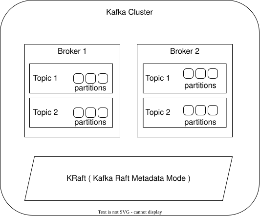

# Apache Kafka

Event Streaming platform used to handle large scale real-time data streams efficiently and reliably.    
Follows publish-subscribe model where producers send messages to topics and consumers read them, making it ideal for real-time data streaming and event driven applications

## Needs for Apache Kafka
- *Real-Time Processing*
- *Fault Tolerance* - replicate data across brokers to prevent data loss
- *Horizontal Scalability*
- *Event-Driven Architecture* - system automatically react to events while reducing continuous polling
- *High Throughput* and *Offset Management*

## Core Components

- **Kafka Broker** : Server responsible for storing and managing data, handle prod-consume requests, support scalability and fault tolerance. Group of brokers work together to form a **Cluster**
-  **Kafka Producer and Consumer**
-  **Kafka Topic** : named category of events where producers and consumers send and subscribe from. Topics are divided into **Partitions** form better scalability. Partitions help in managing large volumes of data.
    - Each partition is an ordered, append-only log.
    - Ordering is guaranteed only within one partition, not across an entire multi-partition topic.
- **Record (Message)** : unit of data in Kafka. Consist of `key + value + offset + headers + timestamp + replication factor`
- **Offset** : position of a **record** inside a partition used by consumers to keep track of how far they have read.

- **Retention** : Unlike traditional message queues that delete a message immediately after it is read, Kafka retains records for a configured time (e.g., 7 days) or size limit. This allows consumers to replay past events.

 
 

# KRaft Mode

Completely eliminating the need for Apache ZooKeeper to manage cluster metadata. Instead of relying on an external system, Kafka brokers manage their own metadata and cluster consensus internally using a Raft-based protocol.

## Components

- *Controller Quorum (Control Plane)* 
- *Active Controller (Leader)*
- *Metadata Log Partition (@metadata)*
- *Follower Controllers and Standard Brokers*